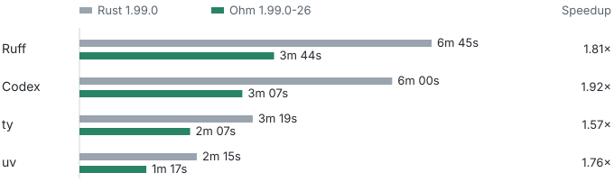
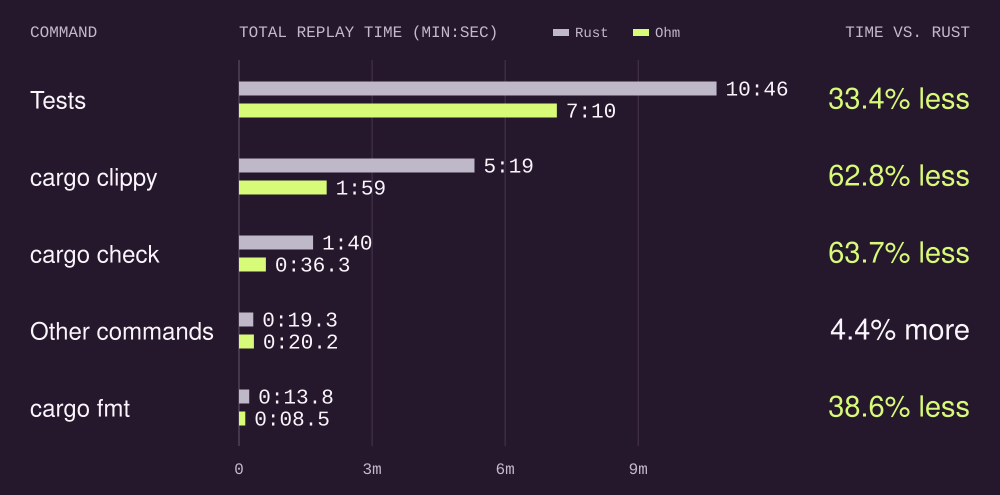
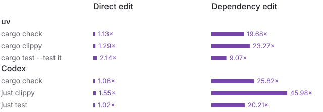
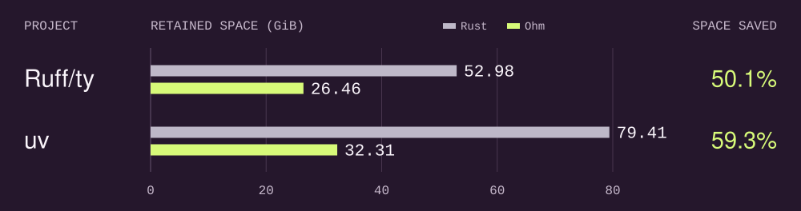

# Ohm

[](https://github.com/astral-sh/ohm/actions/workflows/ci.yml)
[](#license)

An experimental fork of the Rust toolchain, designed for fast, highly parallel local development.

Ohm uses rustc's frontend and borrow checker and runs without a long-lived daemon. We maintain its
optimizations as patches to the stock Rust toolchain, so we can propose individual changes upstream.

With Ohm, incremental builds can be up to 45× faster, replayed development sessions take around
44% less time, and `target/` disk usage decreases by around 55%.

We replayed four development sessions with Rust 1.99.0 and Ohm 1.99.0-26 on x86_64 Linux.
[Session timings](BENCHMARKS.md#replayed-sessions)



Compared to the stock Rust toolchain, Ohm:

- Enables (by default) existing experimental features (e.g., parallel compiler frontends).
- Implements experimental, performance-oriented features proposed upstream (e.g.,
  [Relink, don't rebuild](https://github.com/rust-lang/compiler-team/issues/790)).
- Fixes various performance bugs and regressions (e.g., around `target/` size increases).
- Implements additional optimizations identified by Codex (e.g., reusing build artifacts between
  `cargo build` and `cargo check`, avoiding rustfmt on unchanged files).

**Warning:** Ohm includes backported and experimental Rust, Cargo, and Clippy optimizations that may
be unsound, including an implementation of
[Relink, don't rebuild](https://github.com/rust-lang/compiler-team/issues/790). This README is
human-edited, but all code changes, PR summaries, and additional documentation were authored
entirely by GPT in Codex. Use Ohm only for local development, and at your own risk.

## Installation

Ohm supports Apple Silicon macOS and x86_64 Linux (glibc). Install [rustup](https://rustup.rs/),
then install the latest Ohm release with our standalone installer:

```console
curl --proto '=https' --tlsv1.2 -LsSf \
  https://labs.astral.sh/ohm/install.sh | sh
```

Ohm's installer verifies its embedded archive checksum, installs the complete Rust toolchain, and
registers an exact version and a moving `ohm` alias with rustup, enabling `cargo +ohm` invocations
(e.g., `cargo +ohm check`).

To install an exact version:

```console
curl --proto '=https' --tlsv1.2 -LsSf \
  https://labs.astral.sh/ohm/releases/ohm-1.99.0-9/install.sh | sh
```

To change the installation directory, set `OHM_INSTALL_DIR`:

```console
curl --proto '=https' --tlsv1.2 -LsSf \
  https://labs.astral.sh/ohm/install.sh \
  | env OHM_INSTALL_DIR=/path/to/toolchain sh
```

## Usage

Use rustup's `+toolchain` syntax to select Ohm:

```console
cargo +ohm test
cargo +ohm check
cargo +ohm clippy
cargo +ohm fmt
```

Exact toolchain names have the form `ohm-<rust-version>-<ohm-revision>`.
For example, `cargo +ohm-1.99.0-9 test` selects that installed revision.

Ohm enables dependency-aware rebuild reduction, cached relinking, parallel compiler frontends,
and reuse of previously built registry and workspace dependencies by default.
Opt out with `-Zohm-defaults=no`:

```console
cargo +ohm -Zohm-defaults=no test
```

### `AGENTS.md`

To teach Codex about Ohm, consider adding the following to your `~/.codex/AGENTS.md`:

```markdown
## Ohm Rust toolchain

- Use `cargo +ohm <command>` for all local Cargo commands, including `check`, `test`, `clippy`,
  `fmt`, `metadata`, and external subcommands. Use `rustc +ohm` for direct compiler calls and
  `RUSTUP_TOOLCHAIN=ohm just <recipe>` for task runners.
- Ohm automatically enables `-Zrelink-only`, `-Zpublic-api-hash`, and `-Zthreads=8` when compiling.
  Cargo supplies these flags for you. Direct `rustc +ohm` uses its own defaults.
- Keep a stable, distinct `CARGO_TARGET_DIR` for each worktree. Set `CARGO_BUILD_BUILD_DIR` to a
  separate shared path for all trusted local projects and worktrees using the same Ohm toolchain.
  Keep the shared build directory separate from every worktree target directory, and do not delete
  it when cleaning up an individual project or worktree.
- Create worktrees for local Rust development from an existing Cargo workspace with
  `cargo +ohm worktree add -b <branch> <path> <base>` to seed reusable build state automatically. If
  using custom target directories, pass the new worktree's target directory via `--target-dir`.
- Set `CARGO_UNSTABLE_OHM_PROC_MACRO_TRUST=all` to maximize authenticated registry procedural-macro
  reuse across worktrees. On `cargo +ohm worktree add`, this also opts into importing snapshots
  containing local procedural macros. This opt-in is potentially unsound; avoid it for CI, releases,
  etc.
- Set `CARGO_UNSTABLE_OHM_NATIVE_TOOL_TRUST=all` to maximize reuse of authenticated registry build
  scripts and native-tool helpers across worktrees. This opt-in is potentially unsound; avoid it for
  CI, releases, etc.
- Use `cargo +ohm -Zohm-defaults=no <command>` to disable Ohm's automatic experimental defaults. Use
  plain `cargo <command>` and the repository's normal toolchain for CI and production builds.
```

## Benchmarks

Each pair of bars shows how much time stock Rust and Ohm spent on a command across the four
replays. Tests include `cargo test`, `cargo nextest`, and `just test`.
[Command timings](BENCHMARKS.md#command-timings)



For individual commands, we measured how much faster Ohm was after two kinds of edits. A direct
edit changes the target crate. A dependency edit changes a dependency's implementation while
preserving its public API. [Individual command timings](BENCHMARKS.md#individual-edits)



The disk study compared Rust 1.99.0 and Ohm 1.99.0-11 on macOS (APFS). We measured how much
space ten worktrees retained after running the same workloads. [Disk measurements](BENCHMARKS.md#disk-use)



To preview which build outputs have been idle for at least two days, run
`cargo +ohm gc --max-age 2d --dry-run`.

See the [full benchmark results](BENCHMARKS.md) for developer workflows, build reuse, worktree
startup, and Ruff doctests.

## Philosophy

Rust's compile times and disk usage are increasingly viewed as bottlenecks in day-to-day
development, especially as agents enable us to parallelize across (dozens of) worktrees.

Ohm enables experimental optimizations to improve Rust's iteration speed and throughput. This is a
deliberate tradeoff: we accept the risks of experimental implementations in local development, where
the blast radius of bugs is comparatively limited and the benefits of faster iteration are
substantial (while continuing to use the official toolchain for production builds).

Ohm is authored entirely by GPT in Codex. Agents lower the cost of implementing, testing,
and refining the ideas explored in this project; good ideas can then be proven out and ultimately
proposed upstream. And by forking the toolchain itself, we can change _anything_; we aren't bounded
by the limitations we'd experience as, e.g., a Cargo wrapper.

At present, Ohm includes the following optimizations, all enabled by default:

- Build release compilers with profile-guided optimization (PGO), plus BOLT on Linux. Apply PGO to
  rustdoc, Cargo, Clippy, rustfmt, and cargo-fmt when supported by the Rust revision.
- Run compiler frontends in parallel.
- [Relink, don't rebuild](https://github.com/rust-lang/compiler-team/issues/790): avoid rebuilding
  dependent crates when a dependency's public interface is unchanged (`rustc -Zpublic-api-hash`).
- Cache relinking: reuse compiled code when only the final binary needs to change
  (`cargo -Zrelink-only`).
- Store relink objects per executable, outside dependency search paths, and discard unrelated
  temporary files.
- Find crates by indexing their names and public API hashes, skipping generated object files.
- Index locked dependencies by package name.
- Reuse incremental query dependency edges when promoting cached compiler results.
- Deduplicate metadata for registry and Git dependency libraries.
- Backport faster specialization, privacy checks, and string escaping.
- Skip public API hashing for terminal `cargo check`, `cargo clippy`, and test-harness targets.
- Skip public API hashing for verified immutable registry libraries during cold shared builds.
- Exclude unreachable items from public API hashing.
- Share compiled generic functions across crates.
- Reuse generic-function partitions after edits to private functions or library closures.
- Keep upstream generic instances that capture local closures in the caller's partition.
- Keep codegen-unit merging stable across edits so incremental builds can reuse prior output.
- Reuse encoded metadata prefixes when private edits leave metadata dependencies unchanged.
- Pipeline metadata when a dependency's public API changes.
- Start dependent checks from early interface metadata while upstream function bodies are still
  being checked (`cargo -Zheadstart=no` disables this).
- Reuse integration-test binaries when the edited libraries aren't used by the tests.
- Apply early cutoff to `cargo check` and `cargo clippy`, including with shared registry caches.
- Reuse compiled registry dependencies across builds, checks, tests, and Clippy.
- Reuse compiled workspace dependencies during checks after validating their fingerprints.
- Preserve check graphs across test builds and workspace edits.
- Reuse dependency resolution when only stack, job, or display settings change.
- Use fine-grained build locks that respect file-descriptor limits.
- Avoid repeated compiler-driver validation when reusing registry dependencies.
- Share compiled registry dependencies across worktrees through a separate build directory.
- Avoid duplicate builds when concurrent Cargo invocations need the same registry library with no
  dependencies.
- Format individual changed modules when rustfmt can verify the module graph.
- Combine Clippy lint passes and backport faster redundant-clone checks.

Ohm is exclusively intended for local development: never use it for production builds or releases,
and always verify your work with the official Rust toolchain.

Each Ohm release targets a specific upstream Rust release. When a new Rust version becomes
available, we replay the optimizations that remain relevant and drop those that have already landed
upstream. Multiple Ohm revisions may target the same Rust release; for example, `ohm-1.97.1-20` and
`ohm-1.97.1-21`.

For an explanation of the major optimizations and their measured impact, see
[_How Ohm speeds up development_](docs/optimizations.md).

Ohm's patches are maintained in the following repositories:

- [`ohm-rust`](https://github.com/astral-sh/ohm-rust): Rust compiler and standard library.
- [`ohm-cargo`](https://github.com/astral-sh/ohm-cargo): Cargo.
- [`ohm-rust-clippy`](https://github.com/astral-sh/ohm-rust-clippy): Clippy.
- [`ohm-rustfmt`](https://github.com/astral-sh/ohm-rustfmt): rustfmt.

## License

Ohm is licensed under either of

- Apache License, Version 2.0, ([LICENSE-APACHE](LICENSE-APACHE) or
  <https://www.apache.org/licenses/LICENSE-2.0>)
- MIT license ([LICENSE-MIT](LICENSE-MIT) or <https://opensource.org/licenses/MIT>)

at your option.

Unless you explicitly state otherwise, any contribution intentionally submitted for inclusion in Ohm
by you, as defined in the Apache-2.0 license, shall be dually licensed as above, without any
additional terms or conditions.
